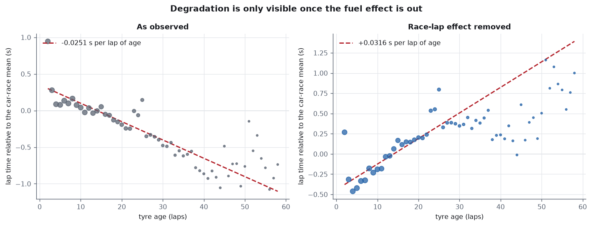
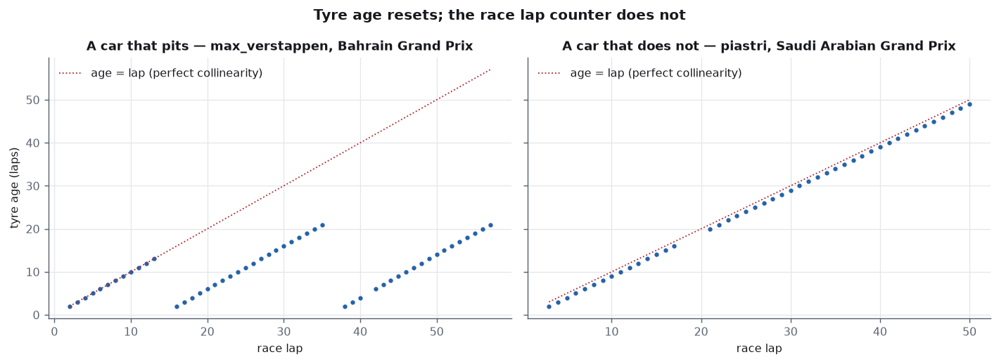
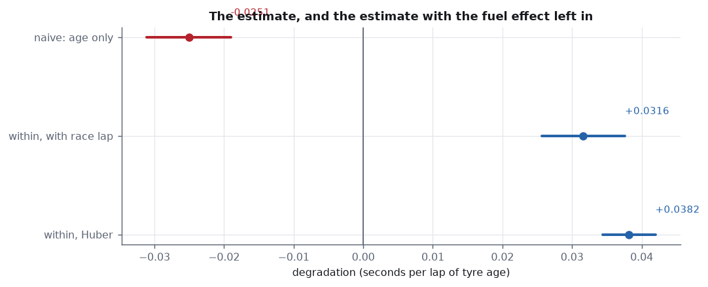
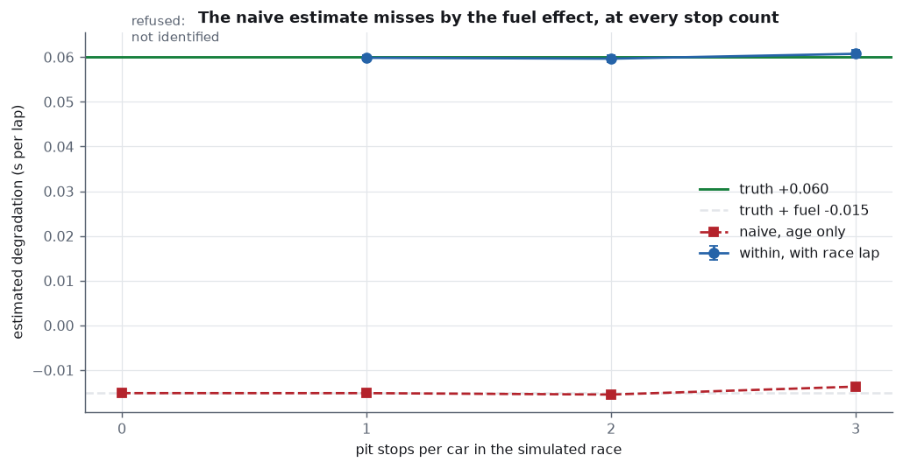
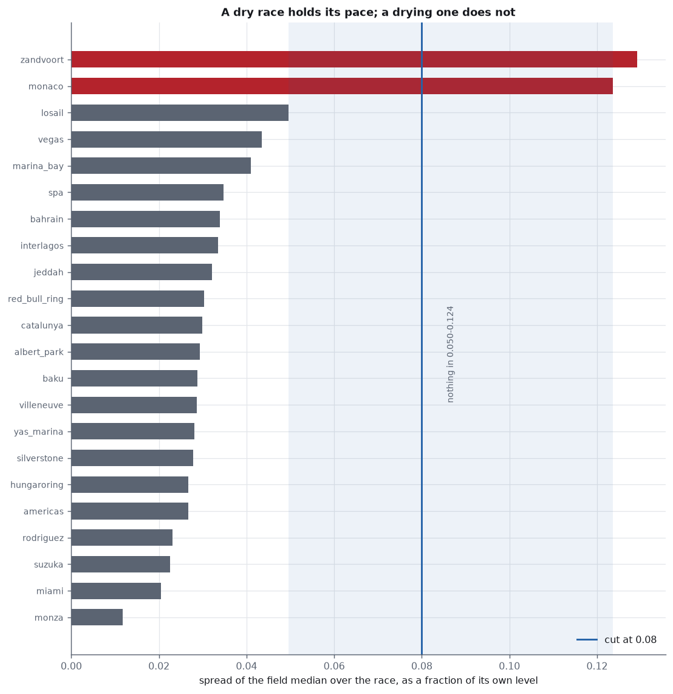
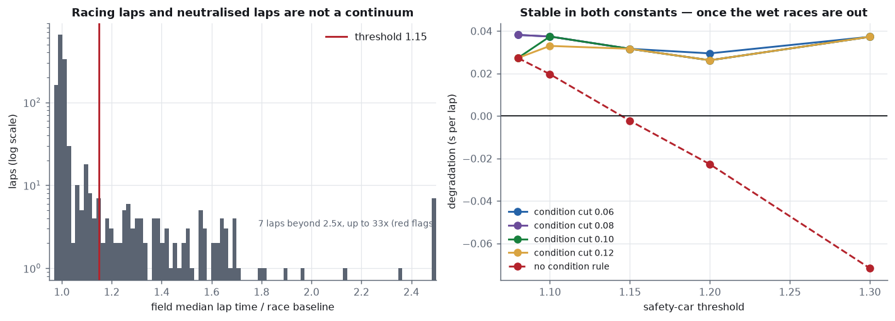
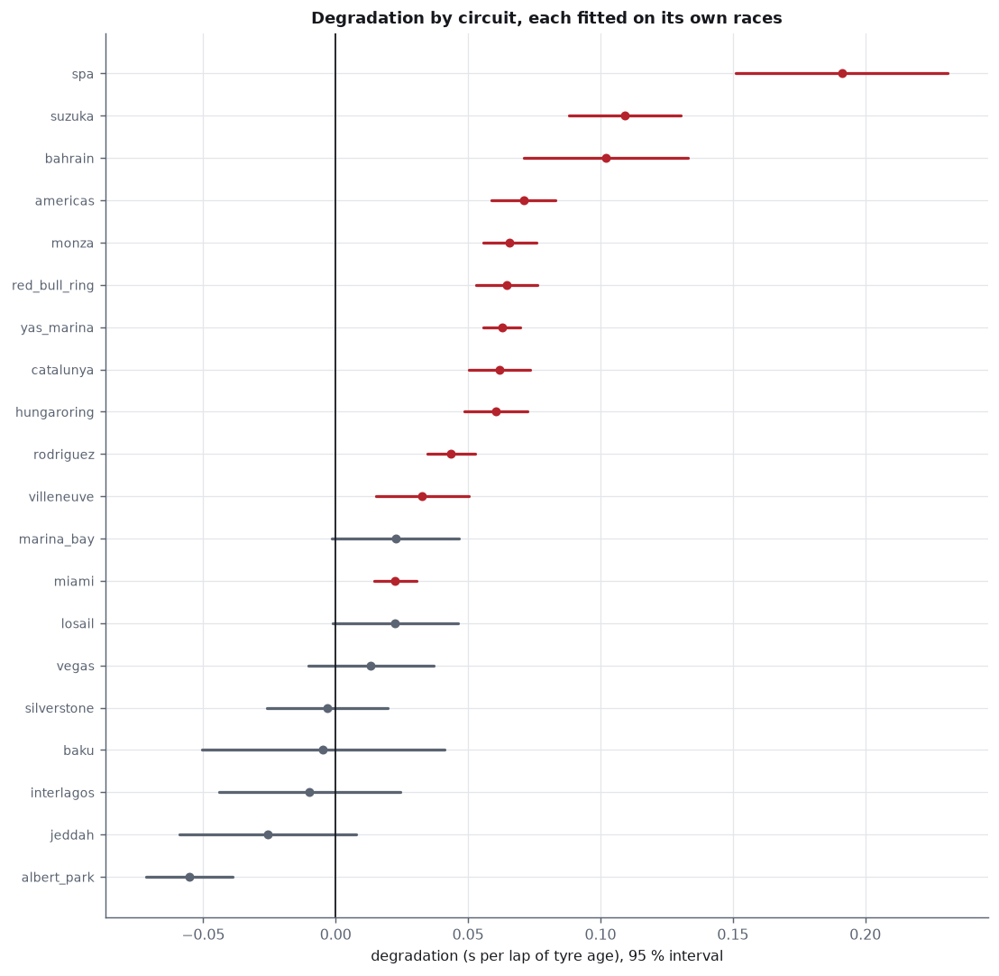
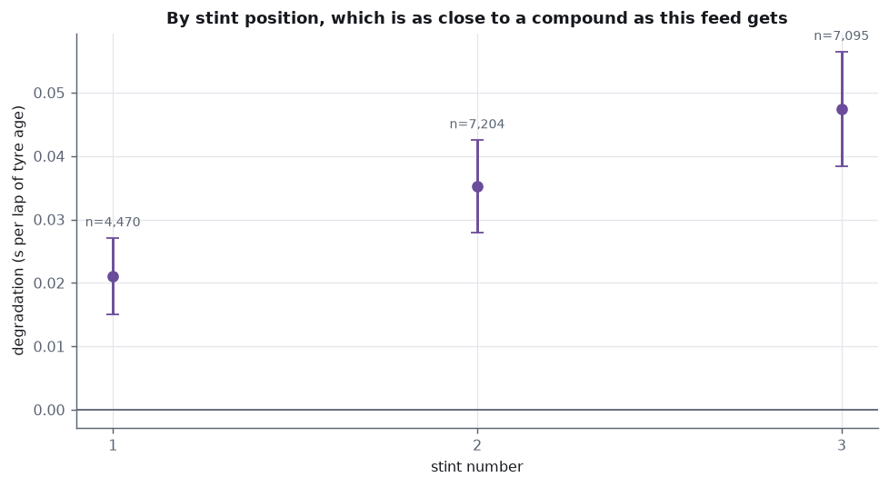
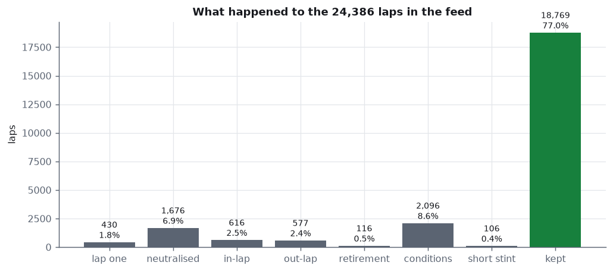
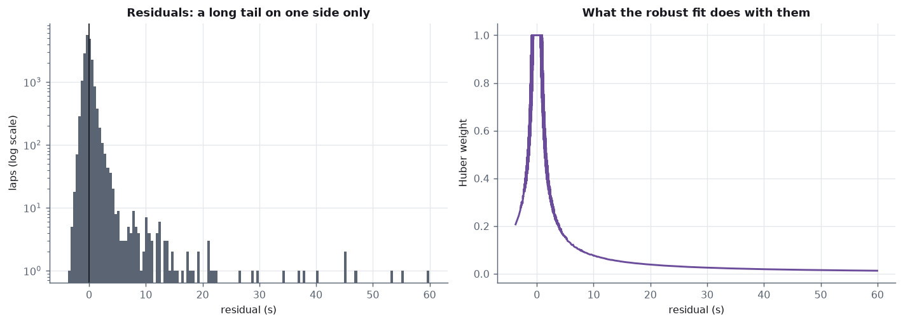

# Stint degradation

Tyre degradation measured from 24,386 Formula 1 lap times, with the fuel
effect estimated out of it rather than assumed away.

The short version: **the obvious estimate has the wrong sign.** Regress lap
time on tyre age within each stint — the natural thing to do, and what a
degradation number usually means — and 2023 says a set of tyres gets
**0.025 s per lap faster** the longer it runs. Put the race lap in the same
model and the same data says they get **0.032 s per lap slower**
(95% CI +0.026 to +0.038). The difference is not noise and not a modelling
preference. It is the fuel load, and inside a stint it is algebraically
inseparable from tyre age unless you put it there on purpose.



```
python run.py              # fetch, clean, fit, chart, report
python run.py --refresh    # re-fetch the season (~8 min, rate limited)
python -m pytest tests/    # 36 tests
```

Output: `out/report.pdf`, a printable report composed in matplotlib.

---

## The identification problem, which is the whole project

A lap time contains at least four things at once:

```
seconds = car-race pace + fuel effect + track evolution
        + tyre degradation + noise
```

The first is handled by a **fixed effect per car-race** — one intercept for
every (season, round, driver) — so a Red Bull lap is never compared with a
Haas lap, and Monaco is never compared with Monza. Every slope below is
estimated inside a single car's own race.

The second and third both move with the **race lap** and in the same
direction: the car burns off fuel and the track rubbers in, so lap times
fall. Nothing in this data separates them from each other, because both are
smooth functions of the same counter. They are estimated as one coefficient
and reported as one. Calling that coefficient "fuel" would be a guess.

The fourth moves with **tyre age**, and tyre age is not the race lap:

```
age = lap − (first lap of the stint) + 1
```

The offset is constant within a stint and jumps at every pit stop. That
reset is the entire identification argument — and a car that never stops
has no reset, so for that car age and lap are the same column twice.



**Why the naive estimate is wrong, and by exactly how much.** Remove the
stint mean from both columns and they become *identical*, because they
differ by a constant within the stint. So a regression of lap time on age
alone cannot return degradation; it returns degradation **plus** the fuel
effect. On simulated data with no noise this holds to twelve decimal
places, which is a test rather than an argument:

```
naive  =  degradation + fuel  =  +0.060 + (−0.075)  =  −0.015
```

Fuel is the larger of the two, so the sum is negative, and tyres appear to
improve with age. On the real 2023 season the same arithmetic lands at
+0.032 − 0.055 = −0.023 against a measured naive estimate of −0.025.

---

## Finding 1 — the estimate, and the two ways of getting it

| estimator | degradation (s/lap) | 95% interval | race-lap term |
|---|---:|---|---:|
| **within, with race lap** | **+0.0316** | +0.0256 to +0.0376 | −0.0546 |
| within, Huber | +0.0382 | | −0.0532 |
| naive, age only | −0.0251 | | — |



Standard errors are clustered on the car-race: 384 clusters, 18,769 laps,
and the degrees of freedom come from the clusters rather than the laps.
Laps within one car's race are not independent draws — a driver nursing a
problem is slow for twenty laps together — and a test confirms that
clustering more than doubles the interval when such a shock is present.

The fixed effects are absorbed by the within transformation rather than by one
dummy column per car-race. The two agree to **3.6e-15 s**, which is
Frisch–Waugh–Lovell doing what it says and a test rather than a citation.

**A cross-check that was not an input.** A car starts on roughly 100 kg of
fuel, burns about 1.8 kg a lap, and a kilogram is worth about 0.03 s a lap:
−0.054 s per lap from fuel alone. The fitted race-lap term is **−0.0546**.
That is closer than it deserves to be — the estimate also contains track
evolution, which should make it larger — so it is reported as a sanity
check and not as a decomposition.

## Finding 2 — the estimator recovers a degradation it was given

A fitter that disagrees with the naive one has not yet shown it is right.
So both are run on simulated races with the two coefficients fixed in
advance (+0.060 s/lap of age, −0.075 s/lap of fuel):



| stops per car | fitted degradation | fitted fuel | naive |
|---:|---|---|---:|
| 0 | *refused: not identified* | — | −0.0151 |
| 1 | +0.0599 | −0.0749 | −0.0151 |
| 2 | +0.0597 | −0.0751 | −0.0155 |
| 3 | +0.0607 | −0.0747 | −0.0137 |

With no pit stops nothing in the sample separates the two effects, the
design matrix is rank deficient after the fixed effects are absorbed, and
**the fitter raises instead of returning a number**. The naive estimator
answers anyway, at every stop count, and is wrong by the fuel effect at all
of them. In the real season 94.5% of the kept laps belong to a car that
pitted, so the split is identified comfortably.

---

## Finding 3 — the first answer was a property of a cleaning constant

The first version of this analysis reported a pooled degradation of
**−0.0022 s/lap**: indistinguishable from zero. It also moved by
**0.099 s/lap** — three times the size of the effect — when the safety-car
threshold was nudged from 1.08 to 1.30, crossing zero on the way. A number
that depends that strongly on an arbitrary constant is a number about the
constant.

The cause was two races. The measure that found them is the spread of the
field's own median lap time over the race, as a fraction of its own level:



Twenty races sit between **0.012 and 0.050**. Zandvoort is at **0.129** and
Monaco at **0.124**. Both were rained on in 2023 — Zandvoort heavily enough
to be red-flagged near the end, Monaco from about lap 52 — and a drying
track makes the entire field faster lap after lap, which is a race-lap
effect of a size no fuel load can produce. It does not corrupt those two
races' own estimates alone: pooled, it drags the shared race-lap
coefficient, and every other circuit's degradation with it.

The rule is therefore: **a race whose own pace drifts by more than 0.08 is
excluded whole**, not lap by lap, because the contamination is in the
race-lap effect rather than in particular laps. The cut sits in an empty
band 0.074 wide, so anywhere inside it removes the same two races.

With that rule in place, both cleaning constants stop mattering:

| safety car | cut 0.06 | cut 0.08 | cut 0.10 | cut 0.12 | no cut |
|---|---:|---:|---:|---:|---:|
| 1.08 | +0.0382 | +0.0382 | +0.0273 | +0.0273 | +0.0273 |
| 1.10 | +0.0374 | +0.0374 | +0.0374 | +0.0330 | +0.0197 |
| 1.15 | +0.0316 | +0.0316 | +0.0316 | +0.0316 | **−0.0022** |
| 1.20 | +0.0295 | +0.0262 | +0.0262 | +0.0262 | **−0.0227** |
| 1.30 | +0.0373 | +0.0373 | +0.0373 | +0.0373 | **−0.0717** |



Across every combination with the condition rule on, the estimate moves by
**0.0119 s/lap** and never changes sign. Down the last column it moves by
**0.0990** and changes sign twice. The fragile constant was never the
safety-car threshold; it was the two races that threshold was being asked
to paper over.

---

## Finding 4 — circuits differ by more than an order of magnitude



| circuit | degradation | 95% interval |
|---|---:|---|
| spa | +0.1912 | +0.1511 to +0.2312 |
| suzuka | +0.1091 | +0.0880 to +0.1303 |
| bahrain | +0.1020 | +0.0710 to +0.1329 |
| americas | +0.0709 | +0.0589 to +0.0830 |
| monza | +0.0657 | +0.0557 to +0.0757 |
| red_bull_ring | +0.0646 | +0.0530 to +0.0763 |
| yas_marina | +0.0628 | +0.0559 to +0.0697 |
| catalunya | +0.0620 | +0.0505 to +0.0736 |
| hungaroring | +0.0606 | +0.0488 to +0.0723 |
| rodriguez | +0.0436 | +0.0346 to +0.0526 |
| villeneuve | +0.0328 | +0.0154 to +0.0501 |
| miami | +0.0225 | +0.0144 to +0.0307 |
| … | | |
| albert_park | −0.0553 | −0.0716 to −0.0390 |

Twelve of twenty circuits have an interval entirely above zero. Spa is the
extreme at **+0.19 s per lap of tyre age**, more than eight times the Miami figure,
which is what a long lap of sustained high-energy corners does to a tyre.

Albert Park comes out **negative with an interval clear of zero**, and it
is left in rather than explained away. The 2023 Australian Grand Prix was
red-flagged three times — a record — with restarts that
reset tyre temperatures and bunched the field, and a final lap run behind
the safety car. The condition measure does not catch it, because the
field's *median pace* stayed stable throughout. It is a real
limitation of the rule, recorded here rather than patched around.

## Finding 5 — later stints degrade faster



| stint | degradation | 95% interval | laps |
|---|---:|---|---:|
| 1 | +0.0211 | +0.0151 to +0.0271 | 4,470 |
| 2 | +0.0353 | +0.0280 to +0.0426 | 7,204 |
| 3+ | +0.0474 | +0.0384 to +0.0565 | 7,095 |

One model, with tyre age interacted with the stint number, so all three
share a single race-lap coefficient. Degradation roughly doubles from the
first stint to the third, and the intervals do not overlap.

The obvious reading is compound: teams tend to start on the harder tyre
available and finish on the softer one, and a softer tyre degrades faster.
**The feed cannot confirm it** — Ergast never recorded the compound, and
the mirror inherits that. Stint position is the closest proxy available,
and it is also confounded with fuel load, track state and the fact that a
third stint happens in races that forced one. The number is solid; the
explanation is a hypothesis.

---

## Four decisions about which laps count

Every rule is structural: it removes laps that are not a car running at its
own pace, for a reason that can be stated in advance. None of them looks at
how slow a lap was relative to the model.



| rule | laps | share |
|---|---:|---:|
| lap one | 430 | 1.76% |
| neutralised (safety car, VSC, red flag) | 1,676 | 6.87% |
| in-lap | 616 | 2.53% |
| out-lap | 577 | 2.37% |
| retirement lap | 116 | 0.48% |
| changing conditions | 2,096 | 8.60% |
| short stint (< 4 usable laps) | 106 | 0.43% |
| **kept** | **18,769** | **76.97%** |

The safety car is detected from the field rather than assumed: a lap whose
median time across every running car exceeds 1.15× the race's own baseline.
The field only slows together when something has neutralised the race — one
slow driver does not move a median, and a test checks that it does not.

**There is deliberately no rule that removes slow laps.** It is the obvious
tidy-up and it is a selection on the outcome, so it cannot be neutral. The
direction is the interesting part: inside a stint, lap times *fall* with
tyre age because the fuel effect is larger than the degradation, so the
slowest laps of a stint are its **earliest** ones, on fresh tyres and a
heavy car. Trimming them cuts the start off every stint and biases the
slope **up** — the opposite of the intuition that says it would flatten the
degradation. A test pins this, including the direction, so the tidy-up
cannot be introduced later.

Traffic is handled where it belongs, in the fit. Being held up adds time to
a lap and never subtracts it, so the residuals are skewed one way; Huber
weights pull in the far tail symmetrically without removing slow laps as a
class.



---

## Three things that changed during the build

**The headline was −0.0022 and meaningless.** It is now +0.0316, not
because the model changed but because the sensitivity check was run before
the write-up rather than after. The pooled estimate moved three times its
own size across an arbitrary cleaning constant, which is what sent me
looking for the two wet races. The original fragile grid is kept as a test:
with the condition rule off, the safety-car threshold must still swing the
answer across zero, so that the problem cannot quietly return.

**I expected trimming slow laps to flatten the degradation, and it does
the opposite.** The first version of that test asserted the estimate would
collapse toward zero. It came back 5% *high*, repeatably, across six seeds.
The reason is the same confounding the project is about, and having written
the explanation down I would not have predicted it in advance. The test now
asserts the measured direction and says why.

**The first clustering test proved nothing.** It added a shock that was
constant across each car's whole race, which the car-race fixed effect
absorbs completely, so clustered and ordinary errors agreed and the test
failed. The shock now lasts one stint — a wrong set-up, a damaged floor —
which is both more realistic and actually correlated within the cluster
without being absorbed.

---

## What this does not do

- **No compounds.** The feed does not record which tyre was fitted, so
  nothing here is a per-compound degradation rate. Stint position is a
  proxy and a confounded one.
- **One season.** 2023 only, 22 races, 20 after the condition rule. Nothing
  here is a trend over time, and a single wet-weather season would move the
  circuit table.
- **Degradation is modelled as linear in age.** The quadratic term is
  −0.00026 s per lap squared with p = 0.12, so curvature is not
  demonstrated — but the binned means do flatten past about 35 laps of age,
  and that is at least partly selection: long stints only happen when the
  tyres are lasting. A proper treatment needs the compound.
- **Fuel and track evolution are one coefficient.** They cannot be
  separated by this data, and the published-physics comparison above is a
  cross-check, not a decomposition.
- **Traffic is down-weighted, not identified.** There is no gap-to-car-
  ahead in the feed, so a lap in dirty air is only visible as a residual.
- **The race-fraction scale is laps, not distance.** A lap of Spa is 7 km
  and a lap of Monaco is 3.3 km, so "per lap" means different things at
  different circuits — which is part of why Spa tops the table.

---

## Fachbegriffe

| English | Deutsch |
|---|---|
| tyre degradation | Reifenabbau, Reifendegradation |
| stint | Stint, Rennabschnitt |
| tyre age | Reifenalter |
| compound | Reifenmischung |
| in-lap / out-lap | Einfahrrunde / Ausfahrrunde |
| pit stop | Boxenstopp |
| safety car | Sicherheitsfahrzeug |
| red flag | rote Flagge, Rennunterbrechung |
| fuel load | Tankfüllung, Kraftstoffmenge |
| fuel correction | Kraftstoffkorrektur |
| track evolution | Streckenentwicklung |
| lap time | Rundenzeit |
| fixed effect | fester Effekt |
| within estimator | Within-Schätzer |
| panel data | Paneldaten |
| identification | Identifikation, Identifizierbarkeit |
| collinearity | Kollinearität |
| omitted variable bias | Verzerrung durch ausgelassene Variablen |
| confounding | Konfundierung |
| least squares | Methode der kleinsten Quadrate |
| robust regression | robuste Regression |
| cluster-robust standard error | clusterrobuster Standardfehler |
| confidence interval | Konfidenzintervall |
| residual | Residuum |
| interaction term | Interaktionsterm, Wechselwirkung |
| sensitivity analysis | Sensitivitätsanalyse |
| selection on the outcome | Selektion auf die Zielgröße |
| rank deficient | rangdefizitär |

---

## Layout

```
src/
  data.py       fetch and cache laps, pit stops and results; time parsing
  stints.py     stint and tyre-age assignment, the four cleaning rules,
                safety-car and changing-condition detection
  model.py      within estimator, cluster-robust errors, Huber variant,
                the naive estimator, and the simulation that validates them
  charts.py     nine figures
  report.py     the printable PDF report
  paper.py      A4 page composition
tests/
  test_degradation.py   36 tests, anchored on algebra and known truths
data/
  season_2023.json      24,386 cached lap times
out/            figures and report, committed so the README renders
run.py
```

## Sources

- Lap times, pit stops and results: [Jolpica](https://api.jolpi.ca/ergast/f1/)
  (Ergast schema, unauthenticated).
- Frisch, R. and Waugh, F. V., "Partial time regressions as compared with
  individual trends", *Econometrica* 1(4), 1933; Lovell, M. C., *JASA*
  58(304), 1963.
- Huber, P. J., "Robust estimation of a location parameter", *Annals of
  Mathematical Statistics* 35(1), 1964.
- Liang, K.-Y. and Zeger, S. L., "Longitudinal data analysis using
  generalized linear models", *Biometrika* 73(1), 1986 — cluster-robust
  errors.
- The three red flags at the 2023 Australian Grand Prix:
  [RaceFans](https://www.racefans.net/2023/04/02/australian-grand-prix-stopped-after-eight-laps-as-albon-crashes/).
- Rain at the 2023 Dutch Grand Prix:
  [RaceFans](https://www.racefans.net/2023/08/27/verstappen-holds-off-alonso-after-late-restart-to-win-disrupted-dutch-gp/);
  at the 2023 Monaco Grand Prix:
  [Motorsport.com](https://us.motorsport.com/f1/news/f1-race-results-monaco-gp-verstappen-2023/10474782/).

Co-authored with Claude Opus 5.
